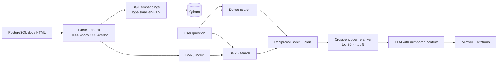

# PostgreSQL Docs Assistant (RAG)

A question-answering system over the official PostgreSQL 18 documentation. It retrieves relevant passages with **hybrid search (BM25 + dense embeddings)**, **reranks** them with a cross-encoder, and generates answers with **inline citations** that link back to the source pages. When the docs don't contain the answer, it refuses instead of guessing.

The project is built and evaluated in stages (dense baseline, then hybrid, then reranking) so each component's effect can be measured.

> **TODO:** add a screenshot or GIF of the UI here (`docs/demo.png`).

## Features

- Hybrid retrieval: dense vectors (BGE) and BM25, merged with Reciprocal Rank Fusion
- Cross-encoder reranking of the top 30 candidates
- Answers cite numbered sources, each mapped to a documentation URL
- Refuses to answer when the context is insufficient
- Evaluation pipeline: hit@k, MRR, and RAGAS (faithfulness, answer relevancy, context recall)
- FastAPI backend, Streamlit UI, Docker Compose setup
- Switchable retrieval mode (`dense`, `hybrid`, `rerank`) for side-by-side comparison

## Architecture



## Tech stack

| Layer | Choice |
|---|---|
| Parsing / chunking | BeautifulSoup, LangChain text splitter |
| Embeddings | `BAAI/bge-small-en-v1.5` (sentence-transformers) |
| Vector store | Qdrant (local mode) |
| Sparse retrieval | `rank_bm25` |
| Fusion | Reciprocal Rank Fusion (k = 60) |
| Reranker | `cross-encoder/ms-marco-MiniLM-L-6-v2` |
| LLM | OpenAI `gpt-4o-mini` |
| Evaluation | RAGAS, hit@k, MRR |
| API / UI | FastAPI, Streamlit |
| Packaging | Docker Compose |

## Results

Evaluated on **TODO: N** questions (**TODO: N** answerable, 6 unanswerable). The `Refusals` column is the number of unanswerable questions the system correctly declined to answer. See [Evaluation method](#evaluation-method) for how the questions were built and what the numbers can and can't show.

| Setup | hit@5 | Faithfulness | Answer relevancy | Context recall | Refusals |
|---|---|---|---|---|---|
| Dense only | 0.97 | 0.93 | 0.96 | 1.00 | 6/6 |
| + Hybrid (BM25 + RRF) | 1.00 | 0.94 | 0.94 | 0.96 | 6/6 |
| + Hybrid + Reranker | 1.00 | 0.96 | 0.95 | 1.00 | 6/6 |

**Takeaways:**

- **Retrieval:** hybrid search raised hit@5 from 0.97 to 1.00, meaning the correct source page was in the top 5 for every answerable question. The reranker kept that and had the best context recall (1.00) and faithfulness (0.96) of the three setups.
- **Generation quality:** faithfulness improved steadily from 0.93 to 0.94 to 0.96 as retrieval improved, so answers stayed closer to the retrieved text. Answer relevancy stayed in a narrow 0.94 to 0.96 band.
- **Refusals:** all setups correctly refused all 6 unanswerable questions.
- **Caveat:** the differences are small. On a question set this size, one or two questions can move a metric by a few points, and the dense baseline was already strong (0.97 hit@5). Read this as "hybrid + reranking is at least as good as dense and slightly better on faithfulness", not as a large improvement. The hybrid row's small dips in context recall (0.96) and answer relevancy (0.94) are within the noise of an LLM judge.

### Failure examples

**TODO:** add 2 to 3 real examples from `eval/results_*.json`.

1. A question dense retrieval got wrong that hybrid or the reranker fixed, with the retrieved URLs before and after.
2. A question the final system still gets wrong, and your diagnosis (chunking, wording mismatch, answer split across pages, and so on).

## Design decisions

- **Hybrid retrieval.** PostgreSQL docs contain many exact identifiers (`shared_buffers`, `pg_stat_activity`, error codes). Dense embeddings tend to blur these, while BM25 matches them exactly. RRF merges the two rankings without needing to calibrate their different score scales.
- **Reranking.** A cross-encoder reads the query and passage together, which is more accurate than comparing precomputed embeddings but too slow to run on the whole corpus. It is applied only to the top 30 candidates.
- **Chunking.** Pages are split into roughly 1,500-character chunks with 200 characters of overlap. Every chunk is prefixed with its page title, and keeps its source URL for citations.
- **Citations and refusals.** Retrieved chunks are numbered in the prompt, and the model must cite them as `[1]`, `[2]`. The system prompt tells it to reply "I couldn't find this in the documentation." when the context doesn't answer the question. Refusal behavior is tested with unanswerable questions.
- **Switchable modes.** Retrieval mode is a parameter (`dense`, `hybrid`, `rerank`), so the same question can be compared across setups in the UI and in evaluation.

## Evaluation method

- **Corpus:** a subset of the PostgreSQL 18 documentation: SQL command reference pages, indexes, runtime configuration, DDL, queries, MVCC, vacuuming, and performance tips.
- **Questions:** candidate questions were generated from randomly sampled chunks with an LLM, then reviewed and filtered by hand. **TODO:** state how many were removed or edited, and how many hard questions were written by hand.
- **Unanswerable questions:** 6 off-topic questions (for example, other databases or unrelated trivia) check that the system refuses.
- **Metrics:**
  - **hit@k / MRR:** whether and where the gold documentation page appears in the retrieved results. No LLM judge is involved.
  - **RAGAS** (faithfulness, answer relevancy, context recall) with `gpt-4o-mini` as the judge.
- **Caveats:**
  - Questions generated from a chunk tend to reuse that chunk's wording, which favors dense retrieval and leaves little headroom for hybrid search and reranking. A harder, hand-written question set (exact identifiers, multi-page questions) is listed under future work.
  - Hit rate is measured at page level (URL), not passage level.
  - LLM-judge scores are noisy. Compare trends between setups instead of reading absolute values.
  - The eval set is small, so differences of one or two questions are within noise.

## Project structure

```
.
├── ingest_pg.py          # HTML -> text chunks (data/chunks_pg.jsonl)
├── index.py              # embeddings -> Qdrant
├── retrieve.py           # dense, BM25, hybrid (RRF), rerank
├── llm.py                # LLM client wrapper
├── generate.py           # retrieval + prompt + answer with citations
├── api.py                # FastAPI service
├── app.py                # Streamlit UI
├── make_evalset.py       # generate candidate eval questions
├── run_eval.py           # run a retrieval mode over the eval set
├── score_ragas.py        # RAGAS scoring
├── make_table.py         # results table
├── Dockerfile.api
├── Dockerfile.ui
├── docker-compose.yml
├── requirements*.txt
└── eval/                 # eval set, saved runs, RAGAS scores
```

## Setup

### 1. Install

```bash
python -m venv .venv
source .venv/bin/activate
python -m pip install -r requirements.txt
export OPENAI_API_KEY="your-key-here"
```

### 2. Download the docs

Download the PostgreSQL 18 documentation pages into `data/raw_pg/`:

```bash
mkdir -p data/raw_pg && cd data/raw_pg
wget -r -l1 -nd -np \
  -A "sql-*.html,indexes*.html,runtime-config*.html,ddl*.html,queries*.html,mvcc*.html,routine-vacuuming.html,performance-tips.html" \
  --wait=0.5 https://www.postgresql.org/docs/18/sql-commands.html
cd ../..
```

### 3. Build the index

```bash
python ingest_pg.py     # writes data/chunks_pg.jsonl
python index.py         # embeds chunks and stores them in data/qdrant
```

### 4. Run locally

```bash
uvicorn api:app --port 8000       # terminal 1
streamlit run app.py              # terminal 2
```

Open http://localhost:8501.

Qdrant's local mode allows only one process to open `data/qdrant` at a time. Stop the API before running `retrieve.py` or the evaluation scripts.

### 5. Run with Docker

Run steps 2 and 3 first, so that `data/` contains the chunks and the Qdrant index. Then create a `.env` file:

```
OPENAI_API_KEY=your-key-here
```

and start the stack:

```bash
docker compose up --build
```

The UI is at http://localhost:8501 and the API at http://localhost:8000. The first request is slow while the reranker model downloads.

## API

```bash
curl -X POST localhost:8000/ask \
  -H "Content-Type: application/json" \
  -d '{"question": "What does VACUUM FULL do?", "mode": "rerank"}'
```

Response:

```json
{
  "answer": "... [1] ... [2]",
  "sources": [{"n": 1, "url": "https://www.postgresql.org/docs/18/sql-vacuum.html"}]
}
```

`mode` is one of `dense`, `hybrid`, `rerank`.

## Reproducing the evaluation

```bash
python make_evalset.py                 # candidate questions -> eval/evalset.jsonl (then review by hand)
python run_eval.py baseline_dense      # dense only
python run_eval.py hybrid
python run_eval.py rerank
python score_ragas.py baseline_dense
python score_ragas.py hybrid
python score_ragas.py rerank
python make_table.py
```

## Limitations and future work

- Fixed-size chunking ignores the documentation's section structure. Heading-aware chunking is a likely improvement.
- The corpus is a subset of the PostgreSQL docs, so questions about other areas are refused.
- No query rewriting, so follow-up questions in a conversation are not resolved against earlier turns.
- The evaluation set is small, and most of its questions were generated by an LLM, so the dense baseline scores high and differences between setups are small.
- Rank-sensitive metrics (hit@1, MRR) and a harder hand-written question set would show the benefit of hybrid search and reranking more clearly.
- No semantic caching, tracing, or CI-based evaluation yet.

## License

**TODO:** choose a license for your code. The PostgreSQL documentation is distributed under the PostgreSQL License; check its terms before redistributing any downloaded pages.
